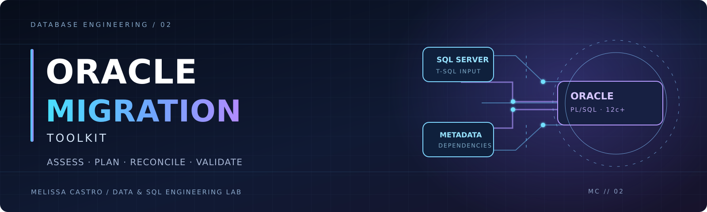
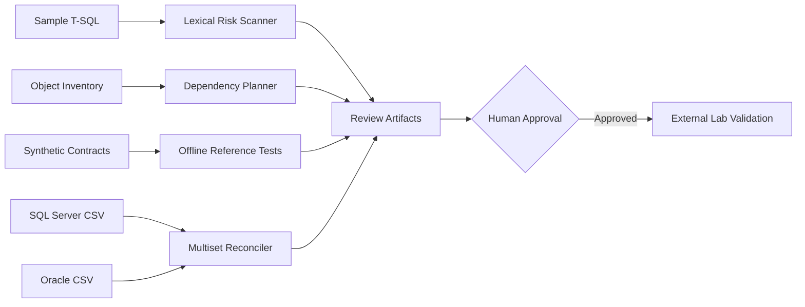

<p align="center">
  
</p>

<h1 align="center">Oracle Migration Toolkit</h1>
<p align="center"><strong>Assessment-first engineering for SQL Server → Oracle transitions.</strong></p>
<p align="center">
  <a href="https://github.com/Dicureck"></a>
  
  
  
  <a href="https://github.com/Dicureck/oracle-migration-toolkit/actions"></a>
</p>

<p align="center"><code>ASSESS → MAP → PLAN → VERIFY → REVIEW → DEPLOY (outside this toolkit)</code></p>

---

## 01 // Mission

SQL migration is not a search-and-replace operation. It is a **compatibility, dependency, and behavioral-equivalence problem**. This independent lab illustrates a review-driven approach to migrating SQL Server patterns into Oracle Database 12c+.

It combines a **conservative T-SQL feature scanner**, a **dependency-aware migration planner**, **synthetic business-rule contracts**, and **multiset reconciliation of exported query results**. All public code, object names, contracts, and datasets are fictional and created for this portfolio.

> **Scope:** This is a reproducible engineering demonstration—not a complete T-SQL parser, a production migration product, or blanket proof of migration equivalence. The core CLI stays **offline and never connects to a database**, while a **separate, opt-in isolated CI harness** now executes selected original paired SQL against both real SQL Server Developer and Oracle Free 26ai ([verified bounded results](docs/verified-cross-engine-parity-2026-10-16.md)).

## 02 // Architecture



| Engineering component | What it demonstrates | Validation boundary |
|---|---|---|
| Static compatibility assessment | Flags T-SQL patterns such as `TOP`, `DATEADD`, `DATEDIFF`, `IDENTITY`, temp tables | Heuristic rules; manual code review required |
| Dependency planner | Detects missing references/cycles and produces a deterministic topological order | Inventory-based; no schema introspection |
| Curated SQL patterns | Original paired T-SQL and Oracle SQL with explicit migration contracts | **Both engines executed** for monthly revenue, Top 10 and new boundary queries in isolated CI; Oracle 12.1 untested |
| Business-rule contracts | Decimal-safe reference outcomes, ranked ties, leap-day boundaries and negative cases | Offline reference plus [actual SQL Server ↔ Oracle Free reconciliation](docs/verified-cross-engine-parity-2026-10-16.md) |
| CSV reconciliation | Detects missing, extra, and duplicate result rows in exported datasets | Exact formatted-string comparisons only |
| Synthetic generator | Deterministically creates imaginary customer/order CSV data | No real entities or client data |
| **Cross-engine runtime gate** | Two independent containers execute original paired queries; a third runner reconciles source rows, five windows and rollback | **Verified on SQL Server 2022 and Oracle Free 26ai only; Oracle 12.1 untested** |

## 03 // Try it in two minutes

**Requirements:** Python 3.11+ and a terminal. No database, credentials, Docker, or paid tool is necessary for the offline workflow.

```bash
# From the repository root
python -m pip install -e .

# Identify T-SQL constructs that need migration review
oracle-migration-lab assess sql/sqlserver --format markdown --output build/assessment.md

# Validate a fictional object inventory and order its dependencies
oracle-migration-lab plan examples/inventory.json --format markdown --output build/plan.md

# Check reference business behavior on purpose-built synthetic cases
oracle-migration-lab verify examples/contracts.json --output build/contracts.json

# Compare exported result sets INCLUDING duplicate-row multiplicity
oracle-migration-lab reconcile examples/exports/sqlserver_monthly_revenue.csv \
  examples/exports/oracle_monthly_revenue.csv --output build/reconciliation.json

# Fabricate deterministic CSVs (output folder must be empty/new)
oracle-migration-lab generate --out build/generated --customers 200 --orders 3000 --seed 42

# Run all offline unit tests
python -m unittest discover -s tests -v
```

You can also use `python -m migration_lab` in place of the installed command. See [`docs/quickstart.md`](docs/quickstart.md) for commands and interpretations.

## 04 // Paired migration patterns

| Case | SQL Server source | Oracle 12c+ candidate | Risk discussed |
|---|---|---|---|
| Date-window aggregation | [`02_monthly_revenue.sql`](sql/sqlserver/02_monthly_revenue.sql) | [`02_monthly_revenue.sql`](sql/oracle/02_monthly_revenue.sql) | Inclusive/exclusive boundaries, leap day, timestamp precision |
| Deterministic Top-N ranking | [`03_top_customers.sql`](sql/sqlserver/03_top_customers.sql) | [`03_top_customers.sql`](sql/oracle/03_top_customers.sql) | `TOP` vs `FETCH FIRST`; mandatory tie-breaker |
| Retrieving generated keys | [`04_returning_id.sql`](sql/sqlserver/04_returning_id.sql) | [`04_returning_id.sql`](sql/oracle/04_returning_id.sql) | `OUTPUT INSERTED` vs `RETURNING INTO`; transaction scope |
| Basic schema mapping | [`01_schema.sql`](sql/sqlserver/01_schema.sql) | [`01_schema.sql`](sql/oracle/01_schema.sql) | `IDENTITY`, precision, `INCLUDE` index behavior |

A separate inventory models a **dependency graph of eight imaginary database objects**, with manual review flags for sensitive stages.

## 05 // Data quality: compare actual exports, not just totals

One row missing from a migrated query can disappear behind a matching `SUM`. This lab compares **multisets**: same values *and* same number of appearances.

```bash
# PASS — same rows in different order, even with differently ordered columns
oracle-migration-lab reconcile examples/exports/sqlserver_monthly_revenue.csv examples/exports/oracle_monthly_revenue.csv

# EXPECTED FAILURE — one occurrence of a duplicate is missing
oracle-migration-lab reconcile examples/exports/sqlserver_monthly_revenue.csv examples/exports/oracle_monthly_revenue_mismatch.csv
```

Exit code `0` means a match; `1` means a mismatch; invalid input returns exit code `2`. Standardize date, numeric and NULL formatting before export. See [`docs/reconciliation.md`](docs/reconciliation.md).

## 06 // Project map

```text
oracle-migration-toolkit/
├── .github/workflows/ci.yml     # Offline tests + review artifacts
├── assets/                     # Original cyber-noir branding
├── docs/                       # Method, decisions and limitations
├── examples/
│   ├── contracts.json          # Leap-day and deterministic-ranking contracts
│   ├── inventory.json          # Fictional dependency graph
│   ├── data/                   # Small fabricated CSV dataset
│   └── exports/                # Synthetic matching / mismatching reports
├── sql/{sqlserver,oracle}/     # Side-by-side curated SQL examples
├── src/migration_lab/          # Static assessment and validation utilities
└── tests/                      # Self-contained Python unittest suite
```

## 07 // Verification & engineering maturity

- **31 local Python unit tests passed** in the authoring environment, covering scanner masking, dependency validation, reference contract cases, CSV multiset semantics, CLI output, and deterministic data generation.
- GitHub Actions runs offline tests on Python 3.11, 3.12 and 3.13, then generates review artifacts.
- **Real SQL Server ↔ Oracle Free functional parity verified** in a [successful three-job CI execution](https://github.com/Dicureck/oracle-migration-toolkit/actions/runs/38946759282) over 26 fictional customers and 260 fictional orders. Original February revenue, Top 10 ranking, 160 month/customer groups and five half-open date windows matched, as did full stored rows and rollback. [Raw outputs and reference verdict are permanently archived](evidence/cross-engine/ci-38946759282/).
- SQL Server **16.0.4305.5 Developer** and **Oracle AI Database 26ai Free 23.26.3.0.0** were actually executed. The differing empty-string/NULL semantics were confirmed and explicitly excluded from the parity claim. **Oracle 12.1.0.2, plan parity and production behavior remain untested.**
- All SQL is provided as **illustrative examples**, not as a production deployment script.

There are intentionally **no** advertised migration throughput gains, no claims of 1:1 production conversions, and no fabricated customer case studies.

## 08 // Further reading

- [Quickstart and command outputs](docs/quickstart.md)
- [Migration methodology](docs/methodology.md)
- [SQL Server → Oracle compatibility matrix](docs/compatibility-matrix.md)
- [Reconciliation design](docs/reconciliation.md)
- [Verified real SQL Server ↔ Oracle Free cross-engine migration case study](docs/verified-cross-engine-parity-2026-10-16.md)
- [Architecture and engineering decisions](docs/architecture.md)
- [Risk register and limitations](docs/risks.md)
- [Security and responsible use](SECURITY.md)

---

<p align="center"><strong>Melissa Castro</strong> · Data Analytics & Business Intelligence · SQL Engineering · Automation<br>
<sub>Building reliable data systems through measurable, reviewable engineering.</sub></p>


**Official GitHub Release:** [v0.1.0](https://github.com/Dicureck/oracle-migration-toolkit/releases/tag/v0.1.0) — CI-gated source snapshot, release notes, and downloadable source archives. [Changelog](CHANGELOG.md).


### Verified two-engine synthetic migration gate

Unlike the offline CLI, the **[isolated real-engine GitHub Actions workflow](.github/workflows/cross-engine-parity.yml)** executes selected *original paired* SQL on both SQL Server Developer 2022 and Oracle Free 26ai. The [2026-10-16 execution](https://github.com/Dicureck/oracle-migration-toolkit/actions/runs/38946759282) passed all three jobs, including independent Python Decimal reconciliation of **260 fabricated orders**, source-row roundtrips, leap-day/month boundaries, Top 10 ordering and rollback. See [case study](docs/verified-cross-engine-parity-2026-10-16.md) and [permanent evidence](evidence/cross-engine/ci-38946759282/).

**Scope boundary:** the verified target is **Oracle Free 26ai, not Oracle 12.1**. Empty-string/NULL behavior was intentionally found different between the engines, requiring explicit migration policy; the validated reporting outputs still matched.

### Optional real Oracle Free syntax smoke

An additional [isolated Oracle Free 23 runtime workflow](docs/oracle-runtime-smoke.md) now tests selected **original synthetic Oracle SQL** when triggered. [The 2026-10-15 real-engine CI test passed](https://github.com/Dicureck/oracle-migration-toolkit/actions/runs/38815481933), and its [Oracle Free 26ai results](evidence/oracle-free-runtime-2026-10-15.json) are archived. This is not evidence of Oracle 12.1 compatibility or cross-engine SQL Server parity. This does not establish Oracle 12.1 or SQL Server cross-engine equivalence.
